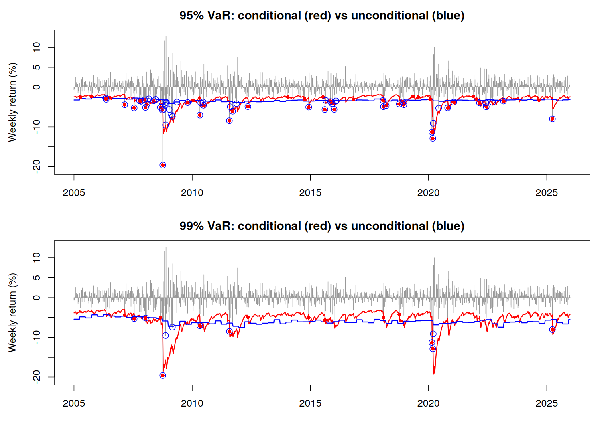
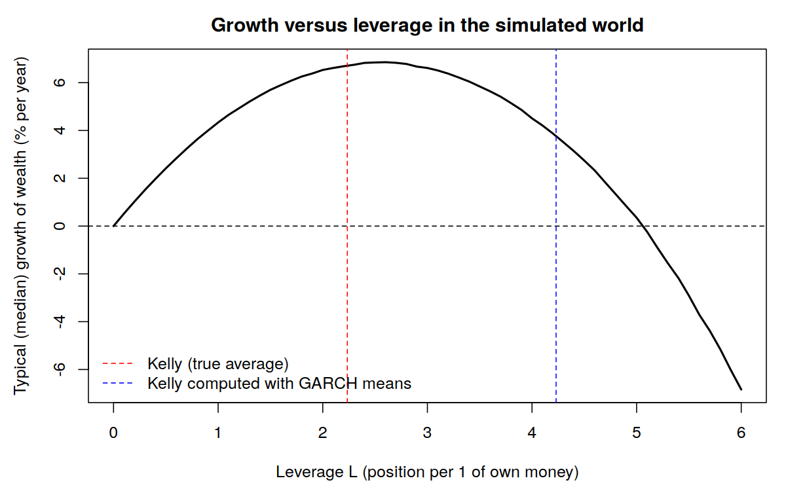

# Pricing vs sizing

**Risk measurement and position sizing for a FTSE 100 / S&P 500 portfolio, in R**

A model can measure risk correctly and an investor can still be ruined by how much they bet. This project shows both halves of that statement with weekly data from 2000 to 2025.

- **Stage 1, risk measurement.** A GARCH–copula model for the one-week Value-at-Risk (VaR) and Expected Shortfall (ES) of an equally weighted FTSE 100 / S&P 500 portfolio, backtested on 21 years of data and checked out of sample on 2026.
- **Stage 2, position sizing.** The Stage 1 model becomes a simulated world in which nothing is mispriced. Investors who differ only in the size of their position are compared, first knowing the true odds and then having to estimate them.

## Key results

**Stage 1**

- Each index is modelled with an AR(0)-GARCH(1,1) model with skewed Student-t shocks, and the dependence between them with a copula. In the data, 7 of the 13 worst FTSE 100 weeks (the worst 1%, measured relative to the volatility at the time) were also among the 13 worst S&P 500 weeks. The selected survival BB1 copula reproduces this (lower tail dependence 0.53). The symmetric Student-t copula, which fits almost as well, gives 0.34. Either way, diversification works in normal weeks but largely fails in crashes.
- The one-week 99% VaR is 4.0% for the first week of 2026, given the calm market at the end of 2025, and 5.9% for a typical week.
- **Backtest, 2005–2025 (1,096 weeks).** Both the conditional and the unconditional VaR get the number of breaches right (Kupiec test). Only the conditional VaR spreads them out over time (Christoffersen test). The unconditional VaR is breached repeatedly in crises, with 13 of its 59 breaches in 2008 alone. Neither anticipates the first week of a crash.
- **Out of sample, January–September 2026.** With the model frozen at the end of 2025, the portfolio breached the 95% VaR in 1 of 39 weeks and the 99% VaR in none: consistent with the model, but a weak test with only 39 weeks.



**Stage 2**

- In the simulated world the Kelly criterion recommends holding £223 of the portfolio for every £100 of one's own money (2.23x leverage). Typical growth is almost flat between about 2x and 3x and falls steeply beyond.
- Replaying the real weeks of 2000–2025 (with hindsight, since the Kelly leverage was computed from the same years), full Kelly fell 87% from its peak at one point. Half Kelly kept 70–84% of full Kelly's growth with half the weekly risk and a 56% worst fall.
- The average weekly return is estimated with a t-statistic of only 1.68: its 95% confidence interval includes zero. A full Kelly investor who overestimates it by one standard error holds £360 per £100 and has a 19.5% chance of losing half their money within a year (4.8% with the true odds). Half Kelly with the same error has a 2.0% chance, but still fell 78% in the real data.
- Averaged over all the estimation errors an investor could make, full Kelly is no longer growth-optimal: a fraction of roughly three-quarters to nine-tenths of Kelly grows fastest (a simple approximation gives 1 / (1 + (SE/mean)²) = 0.73), and half Kelly cuts the average chance of halving within a year from 9.2% to 1.0%.



## Repository structure

```
code/
  stage1_analysis.R            Stage 1: model selection, VaR and ES, copula comparison,
                               backtest (2005-2025) and 2026 out-of-sample check
  stage2_position_sizing.R     Stage 2: simulated world, Kelly leverage, investors who
                               know the odds and investors who estimate them
reports/
  stage1_risk_measurement_report.Rmd / .pdf
  stage2_position_sizing_report.Rmd / .pdf
data/
  FTSE100.csv, SNP500.csv              weekly prices, 2000-2025 (Yahoo Finance)
  FTSE100_2026.csv, SNP500_2026.csv    weekly prices to September 2026
figures/                               all created by the scripts
results/                               saved results the reports read (created by the scripts)
```

Yahoo dates each weekly bar on the Friday or Saturday before its trading week, so the two indices are matched by calendar week.

## How to run

From the repository root in R (tested with R 4.3.3, fGarch 4032.91, VineCopula 2.6.1, ADGofTest 0.3):

```r
install.packages(c("fGarch", "VineCopula", "ADGofTest", "rmarkdown"))
source("code/stage1_analysis.R")         # about 1.5 minutes, mostly the backtest
source("code/stage2_position_sizing.R")  # about 1.5 minutes
rmarkdown::render("reports/stage1_risk_measurement_report.Rmd", knit_root_dir = getwd())
rmarkdown::render("reports/stage2_position_sizing_report.Rmd",  knit_root_dir = getwd())
```

Every number in the reports is read from the scripts' saved results, so the reports always match the code.

## Limitations

- The model is validated for one-week risk. It understates losses that build up over several months, because it makes the size of weekly moves cluster but not their direction. All Stage 2 probabilities of large losses are therefore best read as lower bounds.
- The skewed Student-t distribution slightly underestimates large S&P 500 losses (Anderson–Darling test), so the VaR is mildly optimistic in the extreme tail.
- Returns are price returns without dividends, and borrowing is assumed costless. The Kelly leverage is sensitive to their difference: a net carry of ±1% a year moves it between 1.80 and 2.66.

## Project history: what was group work and what is mine

**Original group coursework (STAT0011 Decision and Risk, UCL, Group 13, March 2026).** The group downloaded the weekly FTSE 100 and S&P 500 data, chose the AR-GARCH(1,1) models with skewed Student-t shocks, tested the transformed residuals for uniformity, selected the survival BB1 copula, and computed a one-week 95% and 99% VaR (3.26% and 5.87%) by simulating 10,000 weeks from the model.

**Problems I found in the coursework and corrected:**

- The two indices were paired by row position, but Yahoo dates some weeks on a Friday and others on a Saturday, so weeks could be mismatched. They are now matched by calendar week.
- The residual diagnostics included the first *p* residuals, which fGarch sets to zero for an AR(*p*) model. These are now dropped.
- The VaR was presented as the risk for the following week, but the 10,000-week simulation forgets its starting point, so it measures a *typical* week (an unconditional VaR). It is now described as such, and a true next-week (conditional) VaR, starting from the volatility at the end of 2025, was added.

**What I added to Stage 1:**

- Expected Shortfall and the conditional (next-week) VaR.
- A comparison of the Gaussian, Student-t and BB1 copulas, with a check against the real data of how often extreme weeks are shared.
- A check that the choice of AR order does not change the result.
- A backtest over 2005–2025 with the Kupiec and Christoffersen tests.
- A conservative rule that uses the larger of the two VaRs.
- An out-of-sample check on 2026.

I also rewrote the code so that every figure and every number in the report is produced by the script, and rewrote the report.

**Stage 2** (position sizing) is entirely my own work.

The code and reports were developed with the help of an AI assistant (Claude, by Anthropic), which I used for programming, checking the calculations and drafting. The analysis choices and conclusions are mine, and I can explain each method.
